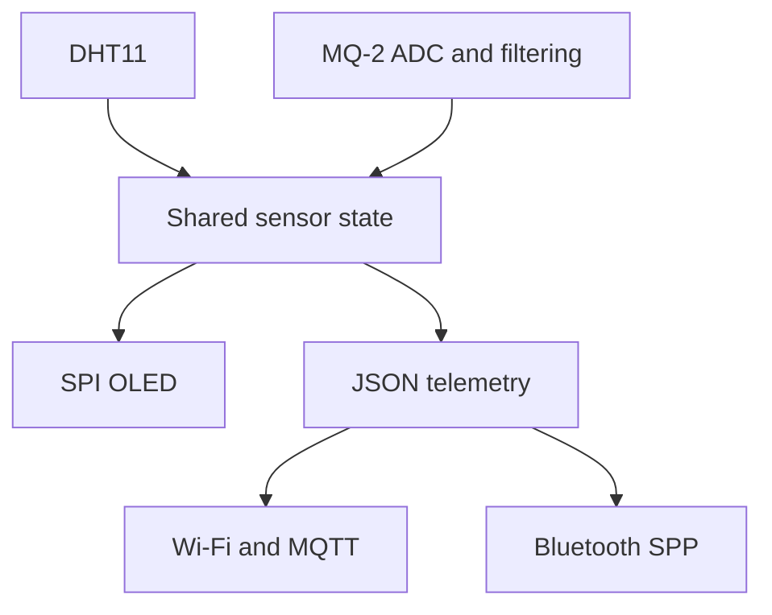

# LifeLink — ESP32 Environmental Monitoring Prototype

LifeLink is a team-built environmental monitoring prototype that reads temperature, humidity, and an MQ-2 gas sensor, displays measurements on an OLED, and sends telemetry to a companion phone dashboard. This repository contains the ESP32 firmware, built with the Arduino framework and PlatformIO.

[Pitch presentation](https://canva.link/gtcudsj52b138ht) · [Prototype video — slide 10](https://canva.link/gtcudsj52b138ht)

## Features

- DHT11 temperature and humidity sampling.
- MQ-2 analog sampling with a clean-air baseline, filtering, and an LPG-equivalent gas estimate.
- A 128 × 64 SH1106 OLED dashboard over SPI, with sensor readings and connection indicators.
- Wi-Fi/MQTT telemetry and Classic Bluetooth SPP telemetry for the companion app.
- A debounced gas alarm and a flashing OLED warning at configured critical thresholds.
- Unavailable/stale sensor indicators on the OLED and explicit validity flags in telemetry.
- FreeRTOS tasks for sensing, display updates, and communications, sharing a mutex-protected sensor snapshot.

These features are implemented in the current source. Gas values are prototype estimates; concentration accuracy has not been established by the supplied evidence. The pitch also discusses a broader product concept; this implementation does not directly detect mold or asbestos.

## Demonstration

The pitch includes hardware descriptions on slide 8, Wi-Fi and Bluetooth dashboard screenshots on slide 9, and a prototype video on slide 10. The video shows the breadboard assembly, powered OLED, and phone dashboard together.

[Watch the video in Canva](https://canva.link/gtcudsj52b138ht).

## Architecture



| Source | Responsibility |
| --- | --- |
| `src/main.cpp` | Peripheral startup, calibration sequence, FreeRTOS tasks, and serial diagnostics |
| `src/config.h` | Pin assignments, device identity, connection settings, thresholds, and update periods |
| `src/mq2.cpp` | ADC sampling, baseline calibration, filtering, and gas estimation |
| `src/sensor_hub.cpp` | Mutex-protected sensor and connection state |
| `src/oled_ui.cpp` | Startup, measurement, and critical-warning screens |
| `src/payload.cpp` | Shared JSON serializer |
| `src/net.cpp` | Wi-Fi reconnection and MQTT publishing |
| `src/bt_bridge.cpp` | Classic Bluetooth telemetry and text commands |

The phone app and any separate web dashboard are not included in this repository.

## Hardware

The prototype uses an ESP32-WROOM development board. The firmware targets the PlatformIO `esp32dev` environment and configures a DHT11, MQ-2 analog module, and SPI SH1106 OLED. See [hardware connections](docs/hardware.md).

### Hardware limitations

- **Gas estimates:** The MQ-2 conversion assumes a 3.3 V sensing circuit, a 10 kOhm load resistor, and no unaccounted output divider. The original supply and divider details are not recorded. Displayed gas values are prototype estimates; rebuilding the device requires suitable input-voltage conditioning and matching the conversion to the sensor circuit.

## Build and run

1. Install PlatformIO, or its VS Code extension.
2. Open this repository as a PlatformIO project.
3. Check the board environment in `platformio.ini` and the pin assignments in `src/config.h` against your hardware.
4. Copy `src/config_local.example.h` to `src/config_local.h` and enter your hotspot details. This local file is ignored by Git. For MQTT, also enter your private broker hostname, TLS port, username, password, and trusted root CA certificate.
5. Build, upload, and open the serial monitor:

```sh
pio run
pio run --target upload
pio device monitor --baud 115200
```

The demonstration used a temporary hotspot. The checked-in Wi-Fi values are placeholders; use your own hotspot in `src/config_local.h`. Pins, thresholds, and update periods are configured in `src/config.h`.

MQTT uses certificate-verified TLS and username/password authentication with a private broker. It remains disabled until the broker settings and root CA are supplied. The firmware waits for network time before connecting and never falls back to plaintext or skips certificate verification. Configure broker access controls for your device topics and give each connected device a unique `LIFELINK_DEVICE_ID`. The phone/web dashboard must use that same broker, credentials, and topics. Bluetooth telemetry works independently.

The original demonstration used a public, unencrypted MQTT broker. That default is removed from this fork; a temporary hotspot does not make a public MQTT topic private.

The checked-in environment is `esp32dev` for the WROOM-based ESP32 Dev Module, with a `huge_app.csv` partition layout. The OLED uses GPIO 16 and 17 for D/C and reset. The firmware uses Classic Bluetooth SPP; the board must support that protocol. The partition layout prioritizes application space over OTA updates.

At startup, the firmware initializes the OLED and DHT11, waits through its configured MQ-2 warm-up, attempts baseline calibration, and then starts communications and periodic tasks. Inspect serial messages for calibration and connection status. Failed MQ-2 calibration leaves gas readings unavailable until a successful calibration; check the circuit and restart in clean air after proper sensor conditioning.

## Telemetry

MQTT status is published to `lifelink/<device_id>/status`; the retained gas-alarm flag is published to `lifelink/<device_id>/alert`. Bluetooth sends newline-delimited JSON using the same status serializer.

Example format, not a measured test result:

```json
{"device":"lifelink-001","temp":27.2,"humi":33,"gas":4,"temp_valid":true,"humi_valid":true,"gas_valid":true,"alarm":0}
```

`temp` is in degrees Celsius, `humi` is relative humidity in percent, `gas` is the firmware's LPG-equivalent estimate, and `alarm` is 0 or 1. Unavailable measurements are JSON `null`, with the matching `temp_valid`, `humi_valid`, or `gas_valid` flag set to `false`. Dashboards must clear the previous value when receiving `null` and must not interpret a false validity flag as a safe reading. The companion apps are separate projects and need to handle these fields.

Failed DHT11 reads immediately clear the affected measurement. MQ-2 rail/saturated readings, insufficient usable samples, or failed calibration report unavailable gas rather than zero or a previous reading. Sensor snapshots also expire after three sampling periods without an update. An active gas alarm is preserved during invalid/stale readings and clears only after a valid gas measurement at or below the alarm threshold. The OLED shows a sensor-unavailable message instead of `Status: OK` during a fault. An ADC cannot reliably distinguish every disconnected sensor from plausible voltage; these checks do not establish gas-detection accuracy.

Bluetooth accepts newline-terminated `PING`, `STATUS`, and `ALARM_RESET` commands. `ALARM_RESET` currently acknowledges the command only; it does not reset the sensor-driven alarm.

Unknown commands receive a JSON error reply. If the escaped reply is too large for the response buffer, the firmware returns `{"error":"reply_too_large"}` without echoing the command.

## Credits

[Christopher Kwok](https://github.com/christophersimonkwok) designed the physical layout of the prototype and built the hardware together with [Samyak Anand](https://github.com/sam6fa50), the original repository maintainer. Samyak also developed the web dashboard and companion apps.

Firmware cleanup and the sensor-validity, telemetry, and MQTT security fixes in this fork were AI-assisted. The team credits above describe the original project contributions.

## Documentation

- [Hardware](docs/hardware.md)
